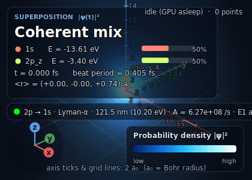
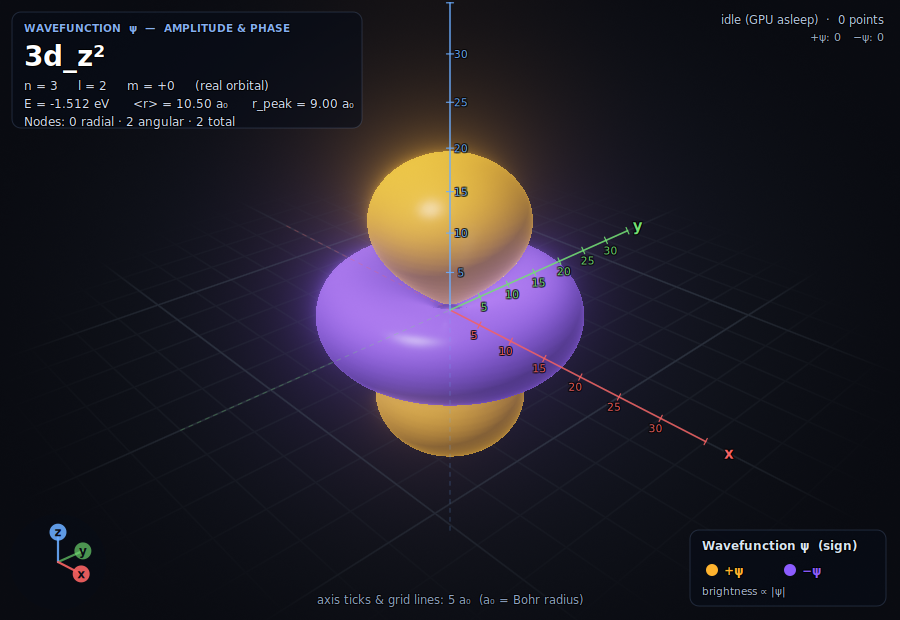
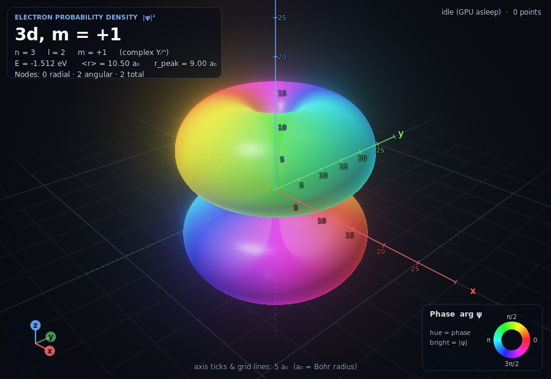
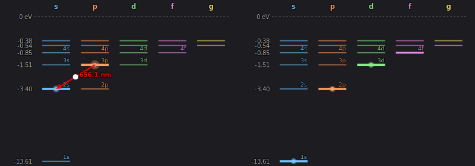

<a id="readme-top"></a>

<!-- PROJECT SHIELDS -->
<div align="center">

[](LICENSE)
[](https://en.cppreference.com/w/c/11)
[](https://www.gtk.org)
[](https://www.opengl.org)
[](#platform-support)
[](https://github.com/XENON-github/hydrogen-sim)

</div>
  <p align="center">
    Interactive 3D Electron Density & Wavefunction Viewer in C, GTK 4 and OpenGL
    <br />
    <br />
    <a href="#features">Features</a>
    &middot;
    <a href="#getting-started">Getting Started</a>
    &middot;
    <a href="#usage">Usage & Controls</a>
    &middot;
    <a href="#sample-output">Sample Output</a>
    &middot;
    <a href="#roadmap">Roadmap</a>
    &middot;
    <a href="#license">License</a>
  </p>
</div>

---

<!-- TABLE OF CONTENTS -->
<details>
  <summary>Table of Contents</summary>
  <ol>
    <li>
      <a href="#about-the-project">About The Project</a>
      <ul>
        <li><a href="#features">Features</a></li>
        <li><a href="#built-with">Built With</a></li>
      </ul>
    </li>
    <li><a href="#screenshots">Screenshots</a></li>
    <li>
      <a href="#getting-started">Getting Started</a>
      <ul>
        <li><a href="#prerequisites">Prerequisites</a></li>
        <li><a href="#installation">Installation</a></li>
        <li><a href="#uninstallation">Uninstallation</a></li>
      </ul>
    </li>
    <li>
      <a href="#usage">Usage</a>
      <ul>
        <li><a href="#launching">Launching</a></li>
        <li><a href="#controls--options">Controls & Options</a></li>
        <li><a href="#examples">Examples</a></li>
      </ul>
    </li>
    <li><a href="#sample-output">Sample Output</a></li>
    <li><a href="#how-it-works">How It Works</a></li>
    <li><a href="#roadmap">Roadmap</a></li>
    <li><a href="#contributing">Contributing</a></li>
    <li><a href="#license">License</a></li>
    <li><a href="#acknowledgments">Acknowledgments</a></li>
  </ol>
</details>

<!-- ABOUT THE PROJECT -->

## About The Project

**Hydrogen Atom Simulator** is a GPU-accelerated desktop application that visualises the exact quantum-mechanical solutions of the hydrogen atom (and hydrogen-like ions). It shows two linked views of the same state: the **electron probability density** |ψ|² and the **wavefunction ψ** itself, with amplitude and phase. Millions of Monte-Carlo samples are drawn from the true distribution, then rendered as soft glowing particles with HDR bloom.

| View | What it shows |
| :--- | :--- |
| **Electron Density |ψ|²** (main window) | Where the electron is most likely to be found |
| **Wavefunction ψ** (second window) | Amplitude **and** phase: +/− sign for real orbitals, a hue wheel for complex ones |

### Features

- **Quantum State Control:**
  - **Any Orbital:** n = 1&ndash;8, 0 &le; l &lt; n, &minus;l &le; m &le; l, plus one-click presets (1s &hellip; 7i).
  - **Real or Complex Basis:** Chemist's real orbitals (p<sub>x</sub>, d<sub>z²</sub>, f<sub>xyz</sub> &hellip;) or complex Y<sub>l</sub><sup>m</sup> eigenstates.
  - **Nuclear Charge Z:** Hydrogen-like ions such as He&#8314; and Li&sup2;&#8314; (orbitals shrink as 1/Z).
- **Live Physics Readout:**
  - Energy, &lang;r&rang;, most probable radius, 90 % probability radius, |L|, L<sub>z</sub>, degeneracy.
  - Radial and angular node counts with **node radii**, plus a radial-probability plot r&sup2;|R(r)|&sup2;.
- **Rendering:**
  - Round soft particles (or lit solid spheres), HDR pipeline with **bloom**, and a soft procedural nucleus glow.
  - Five colour schemes (incl. colour-blind-safe and phase wheel) that switch live, with no resampling.
  - **Cross-sections:** half-space cut or thin slab along x, y or z to look inside the cloud.
  - **Phase animation** e<sup>&minus;iEt/&hbar;</sup>: real orbitals oscillate in sign, complex ones cycle in hue.
- **Superposition States & Time Evolution:**
  - Mix up to **four** eigenstates, &psi;(t) = &Sigma; c<sub>k</sub> e<sup>&minus;iE<sub>k</sub>t/&hbar;</sup> &psi;<sub>k</sub>, with adjustable amplitudes and phases (or load a preset such as 1s + 2p<sub>z</sub>).
  - The cloud really oscillates at the energy differences. The HUD shows simulated time in femtoseconds, the beat period, the dipole &lang;**r**&rang;(t) as a live 3D arrow and a rolling trace.
  - Particles are drawn once from a fixed proposal distribution and re-weighted on the GPU every frame (importance sampling), so evolution costs no resampling.
- **Isosurface Rendering:** GPU ray-marched surfaces of |&psi;| through a 3D volume texture. Choose the enclosed probability (50&ndash;99 %), opacity and detail (64&sup3;&ndash;128&sup3;). Lobes are coloured by sign or by phase, and it works for superpositions too (the surface moves with time), with cross-sections and an optional particle overlay.
- **Energy-Level Diagram & Transitions:**
  - Clickable level diagram (n, l) with a compressed energy axis: left-click picks the state (or adds/removes a state in a superposition), right-click picks the final state.
  - **Transition animation:** the electron is swept from the initial to the final state, with the oscillating dipole, photon wavelength/colour and the E1 selection rule (&Delta;l = &plusmn;1) shown. Forbidden transitions visibly have &lang;**r**&rang; &asymp; 0.
  - Einstein A coefficients, branching ratios and lifetimes for every decay channel of the selected state (e.g. Lyman-&alpha; A = 6.27 &times; 10<sup>8</sup> s<sup>&minus;1</sup>, &tau;(3p) = 5.3 ns).
- **Video / GIF Export:** record the orbiting camera, the time evolution, or both. Animated **GIF** works everywhere with no dependencies; **MP4 (H.264)** and **WebM (VP9)** are produced automatically when `ffmpeg` is on your `PATH`.
- **Readable Scene:** axes with a&#8320; tick labels, grid, orientation gizmo, colour legends, optional 90 % probability sphere and bounding box.
- **Navigation:** orbit / pan / zoom (mouse and touchpad pinch), view presets, linked cameras, auto-rotate.
- **Export:** PNG screenshots of both views (overlay included), plus video / GIF (see above).
- **Fast:** multi-threaded, cancellable sampler (2 million points &asymp; 0.3 s per core); colour mapping and slicing run on the GPU; frames are only drawn when something changes.

### Built With

- **Language:** C (GNU C11)
- **UI Toolkit:** GTK 4
- **Graphics:** OpenGL 3.3 Core (GLAD loader), GLSL 3.30
- **Overlay & Export:** Cairo
- **Concurrency:** POSIX Threads (`pthread`; winpthreads on Windows)
- **Video (optional):** built-in GIF encoder; `ffmpeg` for MP4 / WebM
- **Build System:** GNU Make + `pkg-config`

<!-- SCREENSHOTS -->

## Screenshots
<div align="center">

<!-- 1. Main window: density view -->

<br /><em>Electron density |ψ|² of an orbital</em>
<br /><br />

<!-- 2. Wavefunction window -->

<br /><em>Wavefunction ψ with +/− lobes</em>
<br /><br />

<!-- 3. Side-by-side: sidebar + complex phase wheel -->


<br /><em>Sidebar controls (left) and a complex orbital's phase wheel (right)</em>
<br /><br />

<!-- 4. Cross-section -->

<br /><em>Cross-section slicing to look inside an orbital</em>
<br /><br />

<!-- 5. Superposition time evolution (animated) -->

<br /><em>1s + 2p<sub>z</sub> superposition: the charge cloud sloshes at 0.405 fs (the dipole &lang;z&rang; swings &plusmn;0.74 a₀)</em>
<br /><br />

<!-- 6. Isosurfaces -->


<br /><em>90 % isosurfaces of 3d<sub>z²</sub> (sign colouring) and the complex 3d, m = +1 state (phase wheel)</em>
<br /><br />

<!-- 7. Energy levels -->

<br /><em>Energy-level diagram: a 3p &rarr; 2s transition (Balmer-&alpha;, 656.1 nm, left) and a 1s + 2p + 3d superposition (right)</em>

</div>

<!-- GETTING STARTED -->

## Getting Started

### Prerequisites

You will need a C compiler, `make`, `pkg-config`, the GTK 4 development files (which also provide Cairo), and a GPU driver with OpenGL 3.3 core support. Mesa software rendering also works, just slowly.

#### Arch Linux
```sh
sudo pacman -S base-devel pkgconf gtk4
```

#### Debian / Ubuntu / Kali Linux
```sh
sudo apt update
sudo apt install build-essential pkg-config libgtk-4-dev
```

#### Fedora / RHEL
```sh
sudo dnf install gcc make pkgconf-pkg-config gtk4-devel
```

#### macOS (Homebrew) &mdash; see [Platform support](#platform-support)
```sh
brew install gtk4 pkg-config
```

#### Windows (MSYS2 MINGW64 shell) &mdash; see [Platform support](#platform-support)
```sh
pacman -S --needed mingw-w64-x86_64-toolchain mingw-w64-x86_64-gtk4 mingw-w64-x86_64-pkgconf make
```

#### Optional: MP4 / WebM export
Install [`ffmpeg`](https://ffmpeg.org) and make sure it is on your `PATH` (`sudo apt install ffmpeg`, `brew install ffmpeg`, `pacman -S mingw-w64-x86_64-ffmpeg`). GIF export needs nothing.

### Installation

```sh
# 1. Clone the repository
git clone https://github.com/XENON-github/hydrogen-sim.git
cd hydrogen-sim

# 2. Compile the binary
make

# 3. Run it
./build/hydrogen_simulator
```

Optionally verify the physics, samplers, volume builder and video encoders with the GTK-free tests:

```sh
make test
```

On Linux you can also render real scenes through the actual renderer, shaders and HUD **without a window or GPU** (EGL + Mesa software rendering; needs `libegl1` and the Mesa DRI drivers). It fails if any scene comes out black and leaves the images in `build/gltest/`:

```sh
make gltest
```

### Uninstallation

Nothing is installed system-wide. To remove build artifacts:

```sh
make clean
```

<!-- USAGE -->

## Usage

### Launching

```sh
./build/hydrogen_simulator
```

Two windows open: the main window (sidebar + density view) and the wavefunction window. Closing the wavefunction window only hides it; bring it back from **Windows & export** in the sidebar.

### Controls & Options

#### Mouse

| Action | Effect |
| :--- | :--- |
| Drag | Orbit the camera |
| `Shift`+Drag / Right-drag / Middle-drag | Pan |
| Scroll wheel / Touchpad pinch | Zoom |

#### Keyboard

| Key | Action |
| :---: | :--- |
| `R` / `1` | Isometric view (reset) |
| `2` / `3` / `4` | Front / Side / Top view |
| `Space` | Toggle auto-rotate |
| `P` | Toggle phase animation |
| `G` / `A` / `N` | Toggle grid / axes / nucleus glow |
| `B` | Toggle bloom |
| `H` | Toggle info panel & stats |
| `S` | Save PNG screenshots of both views |
| `T` | Play / pause time evolution (superposition & transition modes) |
| `I` | Cycle render mode: particles / isosurface / both |
| `V` | Start / stop video or GIF recording |

#### Sidebar Sections

| Section | Contents |
| :--- | :--- |
| **Orbital** | Preset, real/complex basis, n, l, m, nuclear charge Z |
| **Physics** | Energy, &lang;r&rang;, node radii, angular momentum, radial-probability plot |
| **Sampling** | Particle count (10 k &ndash; 4 M), resample with a new random seed |
| **Superposition & time evolution** | Mode (stationary / superposition / transition), up to 4 states with amplitude and phase, presets, time speed, &lang;**r**&rang; arrow |
| **Energy levels & transitions** | Clickable level diagram, final state, sweep duration, decay channels, lifetimes and wavelengths |
| **Appearance** | Colour scheme, particle style, size, brightness, bloom, nucleus glow, **render mode and isosurface** (probability, opacity, detail) |
| **Cross-section** | Off / half-space cut / thin slab, axis, position, thickness |
| **Scene overlays** | Grid, axes, nucleus, 90 % sphere, bounding box, info panel, gizmo, legend |
| **Animation & camera** | Auto-rotate, phase animation, camera linking, view presets |
| **Video / GIF export** | View, what to animate, GIF / MP4 / WebM, size, fps, length, overlay on/off |
| **Windows & export** | Show/hide wavefunction window, save PNGs |

#### Developer Environment Variables

| Variable | Description |
| :--- | :--- |
| `HYDROGEN_ORBITAL=n,l,m,complex,Z` | Start with a given state (e.g. `4,2,0,0,1`) |
| `HYDROGEN_SAMPLES=<count>` | Initial particle count |
| `HYDROGEN_SCHEME=<0-4>` / `HYDROGEN_STYLE=<0-1>` | Initial colour scheme / particle style |
| `HYDROGEN_MODE=<0-2>` | Start in stationary (0), superposition (1) or transition (2) mode |
| `HYDROGEN_RENDER=<0-2>` | Start with particles (0), isosurface (1) or both (2) |
| `HYDROGEN_SINGLE=1` | Do not open the second window |
| `HYDROGEN_AUTOSHOT=1` | Save screenshots of both views and quit |

### Examples

**Look inside a 3s orbital with a cross-section:**
Select preset `3s`, set *Cross-section &rarr; Half-space cut*, and drag the *Position* slider.

**Watch a complex orbital's phase rotate:**
Set *Basis &rarr; Complex eigenstates*, pick `3d` with m = +1, choose the *Phase wheel* colour scheme, and press `P`.

**Explore a helium ion:**
Set *Nuclear charge Z* to 2 and compare the orbital size and energy against Z = 1.

**Watch an atom beat (superposition):**
Open *Superposition & time evolution*, set *Mode &rarr; Superposition*, load the preset `1s + 2p_z`, and raise *Brightness* a little (the diffuse 2p part is much fainter than the compact 1s part). Press `T` to pause. The HUD arrow shows the dipole &lang;**r**&rang;(t) and the beat period (0.405 fs).

**Animate a transition:**
Left-click `3p` in the energy diagram, right-click `2s`, then press *Play / restart transition*. Try `2s` &rarr; `1s` (E1-forbidden): nothing oscillates. Compare with `2p` &rarr; `1s`.

**See an orbital as a surface:**
Set *Render mode &rarr; Isosurface*, pick the complex basis and the phase-wheel colours, and slide *Enclosed probability*.

**Record a turntable GIF:**
*Video / GIF export &rarr; Animate: Orbit the camera &rarr; Start recording* (or press `V`). A file such as `hydrogen_3d_z²_density_<timestamp>.gif` is written to the working directory.

**Launch straight into a specific state:**
```sh
HYDROGEN_ORBITAL=4,2,0,0,1 HYDROGEN_SAMPLES=1000000 ./build/hydrogen_simulator
```

<!-- SAMPLE OUTPUT -->

## Sample Output

The **Physics** panel for the 4d<sub>z²</sub> orbital (`HYDROGEN_ORBITAL=4,2,0,0,1`):

```text
4d_z²   n=4  l=2  m=+0  ·  Z=1
Energy         E = -0.850 eV   (16-fold degenerate)
Mean radius    <r> = 21.00 a₀    Peak  r = 21.21 a₀
90% of probability inside r = 30.31 a₀
Angular momentum  |L| = 2.449 ħ,  Lz = 0 ħ
Nodes          1 radial at r = 12.00 a₀ · 2 angular
```

Recordings are saved as `hydrogen_<orbital|superposition>_<density|wave>_<timestamp>.<gif|mp4|webm>`.

Screenshots (`S`) are saved to the working directory as
`hydrogen_n<N>_l<L>_m<M>[c]_<density|wave>_<timestamp>.png` (a `c` suffix marks the complex basis).

<!-- HOW IT WORKS -->

## How It Works

1. **Exact Monte-Carlo Sampling:** The wavefunction factorises as &psi; = R<sub>nl</sub>(r) &middot; Y<sub>l</sub><sup>m</sup>(&theta;,&phi;). The radius is drawn by inverting the cumulative distribution of r&sup2;|R|&sup2;, and the direction by rejection sampling on |Y|&sup2;. This wastes almost no samples, unlike rejection sampling inside a bounding cube. Work is split across threads with independent random generators and can be cancelled instantly when you change orbital.
2. **Compact GPU Data:** Each point is a 16-byte vertex (position, normalised amplitude, phase). Colour mapping, cross-section clipping, phase animation and particle sizing all happen in the vertex shader, so appearance changes are instant.
3. **HDR Rendering:** Particles are blended additively into a half-float framebuffer. A multi-level downsample/upsample bloom pass and tone mapping produce the final image, with energy-conserving particle sizes so brightness stays consistent across zoom levels and sample counts.
4. **Cairo Overlay:** Axes, ticks, legends and the info panel are drawn with Cairo on top of the GL view (and composited into exported PNGs).
5. **Weighted Particles for Superpositions:** Time-dependent densities cannot be inverted analytically, so points are drawn once from a fixed proposal (equal mixture of the component distributions). Each point stores a unit vector of the component values (4 &times; complex, snorm16, 32 bytes/point); the vertex shader forms &psi;&prime; = &Sigma; C<sub>k</sub>(t) b<sub>k</sub> from CPU-supplied coefficients and uses the importance weight K|&psi;&prime;|&sup2; as brightness. The Cauchy&ndash;Schwarz bound keeps weights in [0, K]. A matching amplitude-mode proposal drives the wavefunction view.
6. **Ray-Marched Isosurfaces:** The component wavefunctions are tabulated once on an N&sup3; grid (RGBA16F 3D textures, independent of coefficients). A fragment shader marches each ray, finds sign changes of |&psi;(x,t)| &minus; level, refines them by bisection and shades with a gradient normal. The level comes from a probability histogram so "90 %" really encloses 90 % of the probability.
7. **Transitions:** Dipole matrix elements &lang;j|**r**|k&rang; use an exact Gauss&ndash;Legendre &times; trapezoid angular quadrature and a radial Simpson integral. Einstein coefficients follow A = (4/3) &alpha;&sup3; &omega;&sup3; &Sigma;|&lang;f|**r**|i&rang;|&sup2;, with the m-sum done in closed form.
8. **Video Export:** Recording renders deterministic frames (fixed time step, fixed camera path) into an off-screen framebuffer at the chosen size, composites the Cairo overlay, and feeds a `Recorder`: an in-process GIF89a encoder (median-cut palette, ordered dither, LZW) or a pipe to `ffmpeg`.
9. **Verified Physics:** `make test` checks radial and angular normalisation, the analytic &lang;r&rang; = &frac12;a(3n&sup2; &minus; l(l+1)), real-orbital orientation (p<sub>x</sub> positive along +x), and sampler statistics. The newer tests check Einstein A coefficients and lifetimes against NIST values (Lyman-&alpha; 6.265 &times; 10<sup>8</sup> s<sup>&minus;1</sup>, 3p lifetime 5.27 ns), &lang;1s|z|2p&rang; = 0.7449 a₀, the dipole selection rules, that weighted Monte-Carlo points reproduce the exact &lang;z&rang;(t) and &int;|&psi;|, the 90 % probability radius of 1s, and that the GIF / MP4 / WebM files decode.

### Code Layout

```text
src/hydrogen.c      physics: R_nl, Y_lm, radial tables, derived properties
src/sampling.c      parallel Monte-Carlo sampler (stationary + weighted superposition clouds)
src/superposition.c superposition coefficients, time evolution, dipole matrix, presets
src/transitions.c   E1 transition rates, wavelengths, lifetimes, energy-level layout
src/volume.c        3D wavefunction grid + probability-level table for isosurfaces
src/gifenc.c        built-in animated GIF encoder
src/recorder.c      GIF / MP4 / WebM sink (ffmpeg pipe)
src/platform.c      small Linux / macOS / Windows portability helpers
src/renderer.c      OpenGL pipeline (points, grid, nucleus, bloom, tone map) + embedded GLSL
src/hud.c           Cairo overlay and sidebar radial plot
src/view.c          one 3D viewport: GL area, input, async sampling, frame loop
src/ui.c            sidebar controls
src/app.c           application state, shortcuts, window setup
tests/              unit tests + headless GL harness (make test / make gltest)
docs/images/        README screenshots (replace the placeholders)
```

<!-- ROADMAP -->

## Roadmap

* [x] Arbitrary n, l, m with real and complex orbital bases
* [x] Hydrogen-like ions (nuclear charge Z)
* [x] Multi-threaded exact Monte-Carlo sampler
* [x] HDR rendering with bloom and soft round particles
* [x] Live colour schemes, including colour-blind-safe and phase wheel
* [x] Cross-section slicing and phase animation
* [x] Axes, ticks, legends, gizmo and PNG export
* [x] Superposition states with time evolution
* [x] Isosurface rendering
* [x] Energy-level diagram and transition visualisation
* [x] Video / GIF export
* [ ] Windows and macOS support (portable code, Makefile and CI workflow are in place; not yet verified on real machines, see [Platform support](#platform-support))

<!-- PLATFORM SUPPORT -->

## Platform support

| Platform | Status |
| :--- | :--- |
| **Linux** | Developed and tested. All unit tests and the headless GL scenes pass. |
| **macOS** | Code and Makefile are portable (Homebrew `gtk4`, OpenGL 3.3 core via GTK's GL area). **Not yet tested on a Mac**; the CI workflow builds it. |
| **Windows** | Build via MSYS2 MINGW64 (`make` produces `build/hydrogen_simulator.exe`; `make WINDOWS_GUI=1` hides the console). **Not yet tested on Windows**; the CI workflow builds it. |

`.github/workflows/build.yml` builds and runs `make test` on all three systems (plus `make gltest` on Linux). If a macOS or Windows job fails, the log shows exactly where; please open an issue with it.

<!-- CONTRIBUTING -->

## Contributing

Contributions are welcome! If you would like to help improve the simulator:

1. Fork the Project (`https://github.com/XENON-github/hydrogen-sim`)
2. Create your Feature Branch:
   ```sh
   git checkout -b feature/AmazingFeature
   ```
3. Run `make test` (and `make gltest` on Linux) and make sure they pass
4. Commit your Changes:
   ```sh
   git commit -m "Add AmazingFeature"
   ```
5. Push to the Branch:
   ```sh
   git push origin feature/AmazingFeature
   ```
6. Open a Pull Request

<!-- LICENSE -->

## License

Distributed under the **GNU General Public License v3.0**. See [`LICENSE`](LICENSE) for details.

<!-- ACKNOWLEDGMENTS -->

## Acknowledgments

* [GTK 4](https://www.gtk.org) and [Cairo](https://www.cairographics.org) documentation
* [GLAD](https://github.com/Dav1dde/glad) OpenGL loader generator
* Standard quantum-mechanics treatments of the hydrogen atom (radial Laguerre solutions and spherical harmonics)
* GNU Compiler Collection (`gcc`) & GNU Make

<p align="right">(<a href="#readme-top">back to top</a>)</p>
